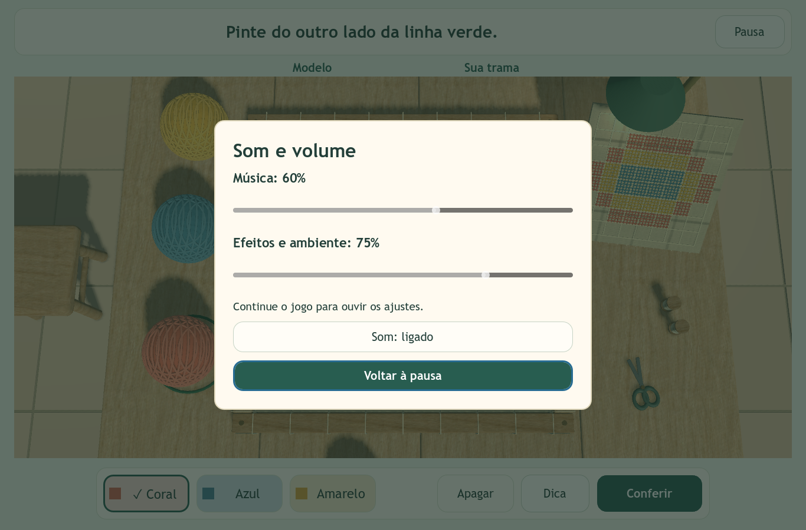

# Música e efeitos no ateliê

## O que ouvir

O jogo utiliza **Etirwer**, de **Kistol**, uma faixa instrumental de violão de aproximadamente **2min10s**, disponibilizada pelo autor sob CC0. O Ogg original está em `audio/music/etirwer-loop.ogg` e funciona offline. A música é apoio à ambientação; não é apresentada como música tradicional de Alagoas.

A tela inicial permanece silenciosa até **Vamos explorar!**. Na exploração, a música entra gradualmente. Ao entrar no bastidor, o ganho contextual diminui 6 dB durante 1,2 segundo. Ao sair, volta ao nível de exploração. O mesmo player permanece ativo, sem recomeçar a faixa.

Na conclusão correta, o efeito toca uma vez e a música recebe uma redução adicional de 8 dB. A redução dura 1,3 segundo e o volume retorna suavemente. A conclusão mantém a personagem parada, mas permite esse retorno sonoro. Perder foco também silencia essa tela.

## Controles

Abra **Pausa → Som e volume**:

- **Música:** volume apenas da trilha; padrão 60%. Zero desliga a música e guarda seu ponto.
- **Efeitos e ambiente:** passos, tecer, conquista, transições e ambiente junto à janela; padrão 75%.
- **Som ligado/desligado:** silêncio global sem alterar os dois níveis escolhidos.

Os percentuais representam a preferência de cada canal, não a mesma intensidade perceptiva para todos os arquivos. Os ganhos de cada player equilibram a mistura. Os sliders aceitam mouse, Tab e setas. A atividade mantém seus sete botões.

Pausar aplica uma saída musical curta de 80 ms e congela o stream. Perder foco suspende imediatamente. Retomar continua do ponto guardado com entrada suave. Ajustar um controle na pausa não toca áudio: continue para ouvir.



## Organização para estudar

| Parte | Responsabilidade |
| --- | --- |
| `default_bus_layout.tres` | Canais `Musica` e `Efeitos`, ambos enviados ao `Master` |
| `scripts/audio.gd` | Player musical único, volumes, fades, pausa, redução na conquista e síntese dos efeitos |
| `scripts/audio_base.gd` | Coordenação básica dos sons da atividade |
| `scripts/main.gd` | Informa entrada/saída do bastidor, pausa, foco e conclusão |
| `scripts/trail_ui.gd` | Dois sliders e botão de silêncio global |
| `audio/music/sources.json` | Autor, origem, licença, tamanho e hash da faixa |

Um **bus** é um canal de mistura: vários players enviam áudio para ele e compartilham seu volume. `AudioStreamPlayer` reproduz a música sem posição no mundo. Os passos e o ambiente usam `AudioStreamPlayer3D` e têm posição no cenário.

`stream_paused` preserva o ponto musical. A troca de modo só altera o ganho; não troca `stream` nem chama `play()` novamente. Cada mudança cancela o Tween anterior antes de criar a nova transição, evitando que uma pausa rápida interrompa uma retomada posterior. A redução temporária de música durante a conquista é chamada de *ducking*.

Os efeitos permanecem sintetizados em PCM mono de 16 bits a 22.050 Hz. Tecer tem quatro pequenas variações de ruído filtrado e contato curto. Passos têm ressonância amortecida no piso e contato mais suave no tapete. A conquista usa três notas sobrepostas, com ataque e final graduais, em 0,84 segundo. A faixa musical é Ogg Vorbis estéreo a 44.100 Hz.

## Como demonstrar

1. Inicie e caminhe. Ouça a música e os passos.
2. Entre no bastidor: a música abaixa e continua no mesmo trecho.
3. No menu, zere Música; retome e pinte para ouvir os efeitos isoladamente.
4. Restaure Música e zere Efeitos e ambiente; retome para ouvir só a faixa.
5. Restaure os níveis, pause e continue para mostrar a preservação do ponto.
6. Use o silêncio global e retome. Ligue de novo e conclua a simetria para ouvir a conquista.

## Verificação

`tests/audio_test.gd` executa a cena real e captura amostras do mixer com `AudioEffectCapture`. Cobre início silencioso, fades, volumes independentes, teclado, pausa, perda de foco, transições rápidas, conquista única e repetição da faixa. `--long-session` acrescenta a reprodução de um ciclo completo.

Resultados e capturas ficam em `evidence/audio/`. `signal-analysis.json` registra duração, picos, energia e junção da faixa. As amostras geradas de tecer, piso, tapete e conquista têm início/fim em zero e nenhuma amostra saturada. O teste mede sinais e estados; a avaliação perceptiva em caixas de notebook, fones e com estudantes precisa de escuta humana.

### Resultado em 13/10/2026

| Execução | Áudio | Interface | Integração | Falhas |
| --- | ---: | ---: | ---: | ---: |
| Projeto na Godot 4.4.1 | 37 | 128 | 55 | 0 |
| Executável Windows exportado | 39 | 128 | 55 | 0 |

O teste Windows executou uma volta completa de 130,23 segundos, além dos testes de repetição, e confirmou áudio após o retorno ao início. A captura de amostras usou o driver WASAPI. As suites do executável carregaram o pacote `.pck` sem depender da pasta do projeto. O menu também foi inspecionado visualmente em 1000 × 680. Os relatórios ficam em `sonoro/`, `interfaces/`, `integracao/` e nas pastas correspondentes em `exportado/`.

Na pasta do projeto, usando o executável Godot instalado:

```powershell
godot --path . --script tests/audio_test.gd -- --evidence-dir=res://evidence/audio/sonoro --long-session
godot --path . --script tests/interface_test.gd -- --evidence-dir=res://evidence/audio/interfaces
godot --path . --script tests/exploration_test.gd -- --evidence-dir=res://evidence/audio/integracao
```

## Fontes

- [Faixa Etirwer e licença declarada pelo autor](https://opengameart.org/content/etirwer)
- [Godot 4.4 — AudioStreamPlayer e stream_paused](https://docs.godotengine.org/en/4.4/classes/class_audiostreamplayer.html)
- [Godot 4.4 — AudioStreamOggVorbis e repetição](https://docs.godotengine.org/en/4.4/classes/class_audiostreamoggvorbis.html)
- [Créditos do projeto](../CREDITOS.md)
