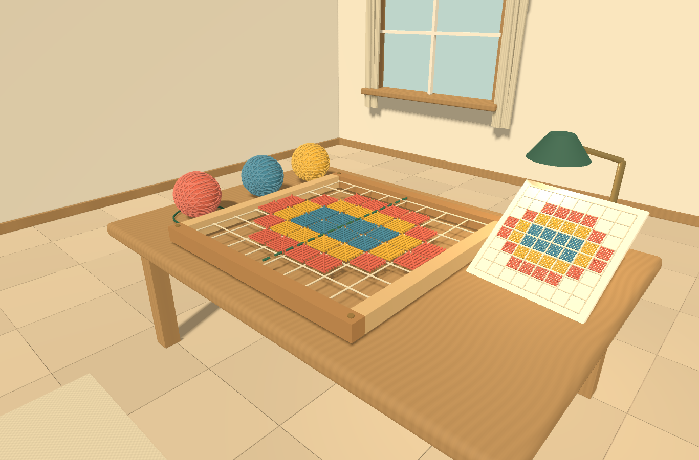
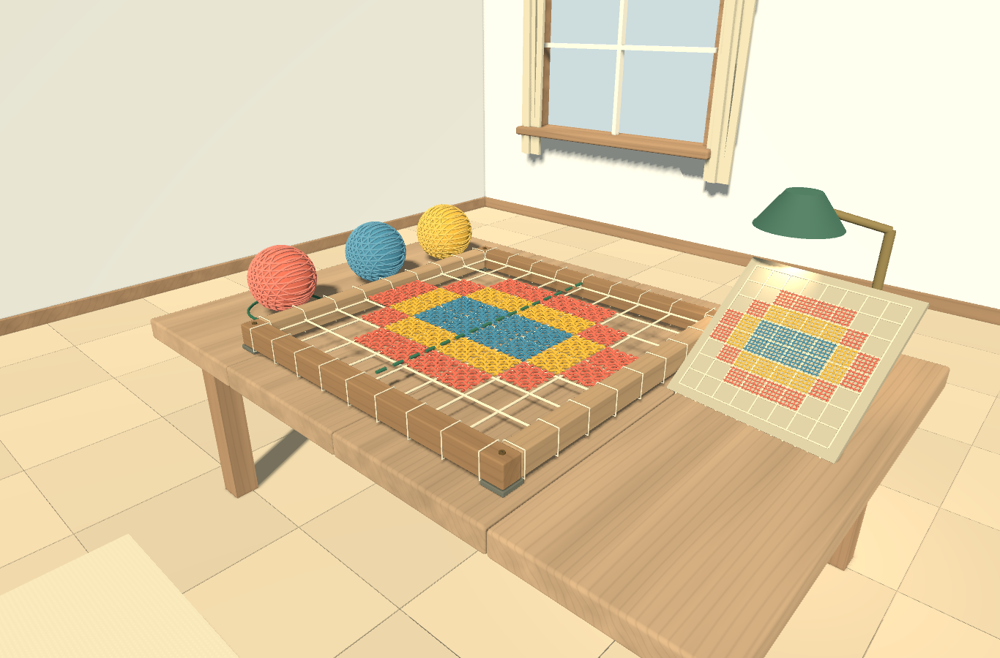
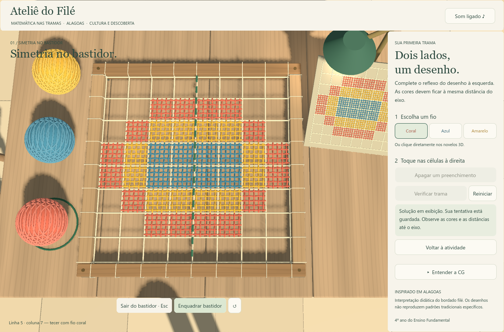

# Entrega 1 — bancada, materiais e iluminação

Concluída em **11/10/2026**, na versão de exploração. O [prompt completo das três entregas](roteiro-3-entregas.md) define a continuidade. A personagem e suas animações ficam para a Entrega 2; a revisão geral da sala, câmera, som e apresentação fica para a Entrega 3.

## Resultado

- **Mesa:** quatro tábuas, juntas estreitas, bordas arredondadas e pequenas diferenças de tonalidade. Veios acompanham o comprimento das tábuas; pés usam direção vertical.
- **Madeira:** variação procedural irregular de cor e rugosidade. As frequências mais finas são atenuadas à distância para reduzir cintilação.
- **Bastidor:** barras com bordas suavizadas, fixações metálicas com ranhura, laçadas ligando malha e moldura e apoios de feltro junto ao tampo.
- **Trama:** dez fios curvos por célula, cinco em cada direção. Alturas opostas alternam os cruzamentos por cima e por baixo. Uma única malha é reutilizada por todas as células.
- **Tecido:** material próprio na peça de inspiração, evitando o fundo claro demais; trama sutil também nos tecidos existentes.
- **Iluminação:** preenchimento mais neutro, luz principal quente e luminária direcionada. As cores do exercício permanecem distintas.
- **Otimização:** 27 voltas de cada novelo reunidas em uma malha; três materiais de fio compartilhados entre as células.

Os desenhos continuam sendo interpretações didáticas. O entrelaçamento é uma simplificação visual e não pretende reproduzir a execução artesanal de um ponto tradicional de filé.

## Comparação visual

Capturas reais da Godot, no mesmo enquadramento, em 1366 × 900.

### Antes



### Depois



### Atividade



## Validação

- **40 verificações de integração: zero falhas.** Caminhada, colisões, câmera, interação, preservação da tentativa, cores, apagar, verificação, solução, reinício, CG, foco, pausa e silêncio global.
- Modelo matemático aprovado.
- Importação final pelo editor concluída com código de saída zero.
- Capturas da exploração, atividade, solução e bancada inspecionadas visualmente. Artefatos de sombra encontrados durante o ajuste foram corrigidos antes da entrega.

Logs e resultados estão em `evidence/entrega-01/`. Não houve avaliação auditiva humana nem teste em outro computador.

## Desempenho comparável

Windows, Godot 4.4.1 Standard, Compatibility, AMD Radeon RX 7600, 1366 × 900. O script `tests/visual_review.gd` usa as mesmas câmeras, 60 quadros de aquecimento e 180 quadros de medição por vista, com **VSync desativado apenas nesse script**. A configuração normal do jogo foi preservada.

| Vista / medida | Antes | Depois |
| --- | ---: | ---: |
| Exploração — chamadas de desenho | 1.725 | 1.241 |
| Exploração — mediana do tempo por quadro | 4,036 ms | 2,085 ms |
| Exploração — percentil 95 | 7,959 ms | 4,105 ms |
| Solução no bastidor — chamadas de desenho | 1.550 | 989 |
| Solução no bastidor — mediana do tempo por quadro | 2,886 ms | 1,409 ms |
| Solução no bastidor — percentil 95 | 5,117 ms | 2,467 ms |

Na vista do bastidor, as chamadas de desenho caíram aproximadamente **36%**. A geometria curva acrescenta detalhe; o total de primitivas registrado nessa vista passou de 504.730 para 506.974. A combinação de malhas e a redução de pequenas sombras compensaram o custo neste ensaio.

São amostras curtas, sensíveis a aquecimento, driver e carga da máquina. Não representam taxa mínima garantida nem benchmark de outros equipamentos. A antiga medição de cerca de 33,5 ms tinha VSync e outras condições; não deve ser comparada diretamente a estes números ou tratada como limite do hardware. O teste de integração desta entrega, com a configuração normal, registrou mediana de 16,681 ms em sua amostra de 90 quadros.

## O que estudar para apresentar

| Conceito de CG | Onde observar / explicar |
| --- | --- |
| Modelagem e normais | `tools/geometry.gd`: cantos arredondados; `tools/refine_workbench.gd`: construção das superfícies dos fios |
| Curvas paramétricas | A função `center()` usa cosseno para alternar a altura dos fios nos cruzamentos |
| Materiais | `materials/wood.gdshader`, `fabric.gdshader` e `thread.gdshader`: cor, rugosidade e detalhe procedural |
| Hierarquia e escala | O bastidor e a bancada preservam a escala 0,52; detalhes são modelados nas coordenadas locais |
| Luz e sombras | A Godot calcula a iluminação e o mapa de sombras; o projeto define posição, direção, cor, intensidade e parâmetros |
| Reutilização | Uma malha de preenchimento e três materiais atendem todas as células; voltas dos novelos são combinadas |

O projeto gera geometria e configura materiais; a engine fornece rasterização, iluminação, shaders, seleção e física. Os shaders seguem a [referência de shaders espaciais da Godot 4.4](https://docs.godotengine.org/en/4.4/tutorials/shaders/shader_reference/spatial_shader.html). Os recursos usados permanecem compatíveis com o [renderizador Compatibility](https://docs.godotengine.org/en/4.4/tutorials/rendering/renderers.html).

## Arquivos e reprodução

As cenas estão prontas: **importe `project.godot` e pressione F5**. Use E em frente à mesa. Não é necessário executar os geradores para jogar.

Para reconstruir a modelagem desta entrega deliberadamente, na pasta do projeto:

```powershell
godot --headless --path . --script tools/refine_workbench.gd
godot --headless --path . --script tools/build_exploration.gd -- --room-only
```

Esses comandos substituem as cenas geradas. `--room-only` preserva a personagem. O antigo `tools/merge_threads.gd` pertence à primeira versão e não deve ser usado para reconstruir a trama curva.

Para novas capturas, use um rótulo novo, preservando a evidência da entrega:

```powershell
godot --path . --resolution 1366x900 --script tests/visual_review.gd -- revisao-local
```

O backup anterior está fora do projeto, em `entregas/exploracao-antes-entrega-01.zip`, na pasta de trabalho. O ZIP da entrega contém apenas o projeto, sem a engine e sem caches `.godot`.

## Limitações e próximas entregas

- Fios coloridos recebem iluminação, mas não projetam sombras próprias; isso evita pequenas sombras instáveis e reduz custo. Moldura, malha base, novelos e móveis mantêm sombras.
- Não há iluminação global calculada nem luz fisicamente simulada atravessando vidro. A composição usa luz direcional, ambiente e um foco de trabalho.
- Personagem e caminhada continuam simplificadas: Entrega 2.
- Ambientação adicional, câmera/interface, som e revisão da apresentação: Entrega 3.
- Continua sendo um projeto editável Godot, sem novo executável Windows exportado.
