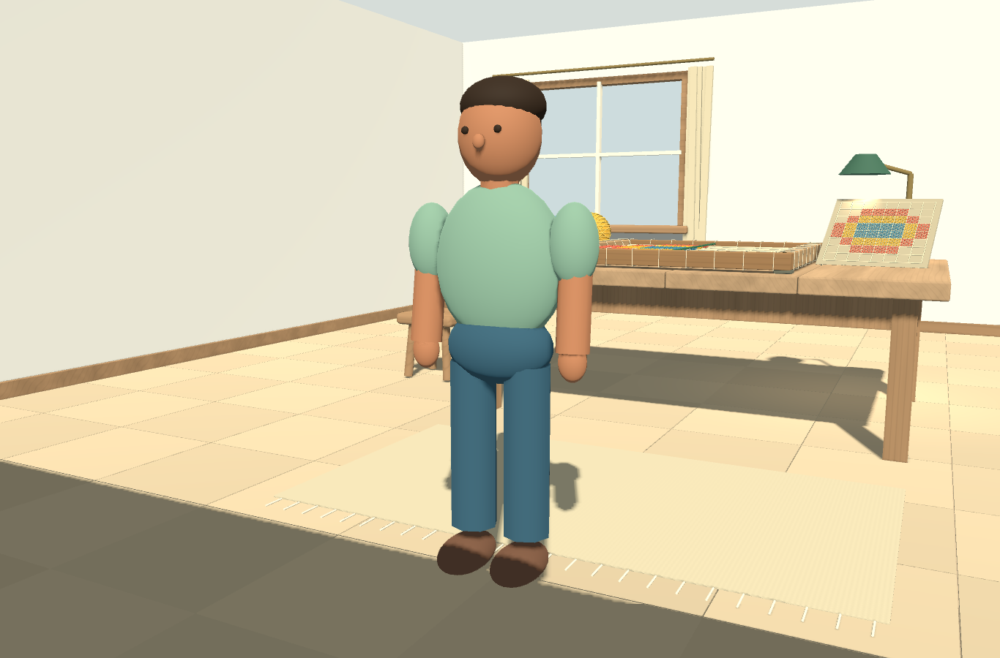
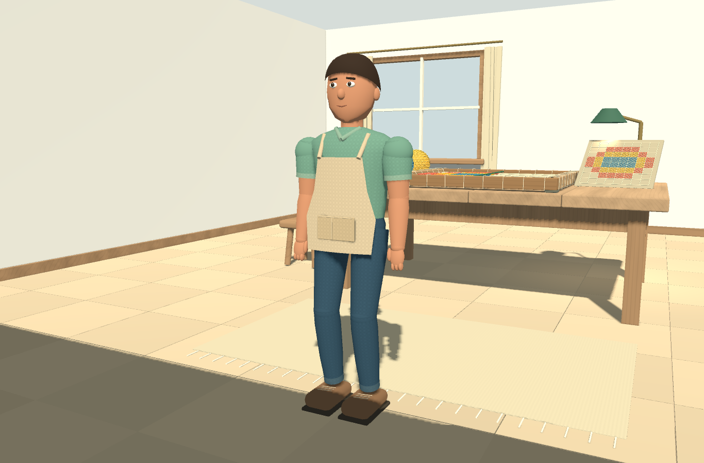
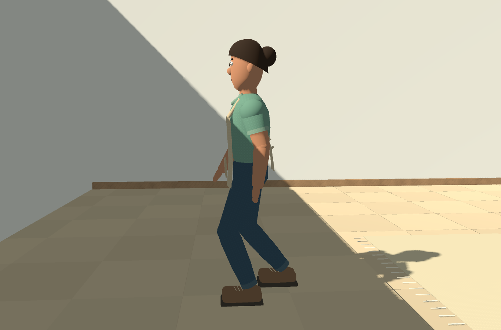

# Entrega 2 — personagem e movimento

Concluída em **11/10/2026**, sobre a Entrega 1. A bancada, os materiais da sala, a iluminação e as cenas educativas da entrega anterior foram preservados. A comparação SHA-256 dos recursos registrados, exceto `personagem.tscn`, encontrou zero alterações. O projeto original `godot-atelie-file` também permaneceu intacto.

## O que mudou

- **Modelagem:** torso, cabeça, braços e pernas com seções de largura variável; proporções mais próximas de uma pessoa de aproximadamente 1,79 m.
- **Aparência:** cabelo preso, olhos, sobrancelhas, orelhas, nariz e boca; mãos com palma, polegar e dedos simplificados.
- **Roupa:** blusa com gola e mangas, avental com alças, bolso e laço; calça com barras; calçados com sola e cadarços.
- **Articulações:** ombros, cotovelos, punhos, quadris, joelhos e tornozelos em hierarquia editável.
- **Caminhada:** pés alternam apoio e movimento, joelhos flexionam e braços acompanham em oposição. A posição de um pé apoiado é mantida no mundo enquanto o corpo avança.
- **Parada:** desaceleração, retorno alternado dos pés à posição neutra e respiração discreta.
- **Controles:** velocidade de 1,55 m/s, aceleração e desaceleração distintas, limite de giro em radianos por segundo e velocidade diagonal limitada. Inclinar a câmera não muda a velocidade horizontal.
- **Som:** o evento de passo coincide com a conclusão do apoio durante deslocamento real. Os recursos de áudio e o mute existentes foram mantidos.

## Capturas

### Antes



### Depois



### Movimento



Há quatro capturas sucessivas da caminhada em `evidence/entrega-02/depois/`, além da vista de exploração, perfil e retorno ao bastidor. São capturas da Godot, sem retoque.

## Árvore e responsabilidades

```text
Personagem — CharacterBody3D / player.gd
├── CollisionShape3D — cápsula de 1,78 m, raio 0,23 m
├── Visual — character_pose.gd / orientação visual
│   └── Corpo — altura do quadril
│       ├── Quadril
│       ├── Tronco
│       │   ├── Blusa, Avental e Cabeca
│       │   ├── BracoE → Cotovelo → Punho
│       │   └── BracoD → Cotovelo → Punho
│       ├── PernaE → Joelho → Tornozelo → ContatoChao
│       └── PernaD → Joelho → Tornozelo → ContatoChao
└── CameraPivot → SpringArm3D → Camera3D
```

`player.gd` lê a entrada, calcula velocidade, gravidade e rotação, e chama `move_and_slide`. A base visual pode girar sem girar a cápsula ou a câmera. A API física da Godot fornece colisões e velocidade efetiva; o projeto define a resposta aos controles. Referência: [CharacterBody3D da Godot 4.4](https://docs.godotengine.org/en/4.4/classes/class_characterbody3d.html).

`character_pose.gd` recebe a velocidade real após colisões. Um pé fica apoiado enquanto o outro percorre um arco até a próxima posição. Consultas ao piso determinam a altura do apoio; uma consulta horizontal limita a passada perto de obstáculos. Ao parar, cada pé volta à sua posição neutra.

O joelho é calculado por **cinemática inversa**: a posição desejada do pé determina como coxa e canela devem girar. O código resolve um triângulo com comprimentos de 0,415 m e 0,425 m e limita alvos inalcançáveis. A orientação do sapato permanece horizontal durante o apoio. Não há Skeleton3D ou animação importada; os pivôs são nós Node3D.

Transformações locais organizam os membros; posições globais mantêm os pés apoiados enquanto seus pais se movem. A Godot compõe as matrizes da hierarquia. Referência: [transformações 3D na Godot 4.4](https://docs.godotengine.org/en/4.4/tutorials/3d/using_transforms.html).

## O que a equipe precisa aprender

| Tema | Exercício curto |
| --- | --- |
| Hierarquia | Gire um cotovelo no Inspector e observe que só o antebraço e a mão acompanham |
| Coordenadas locais e globais | Compare `rest_anchor`, `feet` e `body.to_local` em `character_pose.gd` |
| Cinemática inversa | Desenhe o triângulo quadril–joelho–tornozelo e localize `along` e `bend` em `solve_leg` |
| Movimento independente de quadros | Identifique o uso de `delta` na aceleração e no giro; não multiplique a velocidade por `delta` antes de `move_and_slide` |
| Animação procedural | Observe `swing_elapsed`, interpolação suave e arco com seno; explique por que o som só dispara ao concluir um passo real |
| Modelagem e normais | Examine as seções da função `loft` em `character_builder.gd`; elas definem silhueta e orientação das superfícies |

## Verificação

**79 verificações automatizadas aprovadas:** 39 de movimento e 40 de integração. O teste do modelo matemático também passou. A importação final pelo editor terminou com código de saída zero e sem erros no log `import.log`.

### Movimento

Godot 4.4.1, Windows, AMD Radeon RX 7600, janela gráfica, VSync desativado no ensaio. O teste usa a personagem real sobre piso plano isolado. “Limite de FPS” é a configuração de renderização solicitada ao motor; não é uma garantia de desempenho em outro equipamento.

| Limite de renderização | Frequência da física | Distância em 2 s |
| ---: | ---: | ---: |
| 30 FPS | 60 Hz | 2,941 m |
| 60 FPS | 60 Hz | 2,941 m |
| 120 FPS | 60 Hz | 2,941 m |
| 120 FPS | 30 Hz | 2,953 m |
| 120 FPS | 120 Hz | 2,934 m |

A variação entre os casos foi de **1,91 cm**. O maior deslocamento horizontal de um pé durante uma atualização de apoio foi inferior a **0,25 mm** no ensaio de caminhada reta. A sola permaneceu cerca de 1 mm acima do piso, e a elevação durante a passada chegou a aproximadamente 6,6 cm. Esses números não garantem ausência de deslizamento em qualquer giro ou terreno.

Também foram verificados desaceleração, ausência de passos parada, velocidade diagonal, direção relativa à câmera e bloqueio dos controles. Evidências: `motion.log` e `motion-results.json`.

### Integração

Passaram as verificações de piso, paredes, mesa, estante e banqueta, proteção da câmera, proximidade, entrada/saída do bastidor, bloqueio do movimento na atividade, tentativa preservada, seleção, apagar, solução, verificação, reinício, transformações, sombras, foco, pausa e mute.

Ensaios preliminares foram afetados por troca de foco do desktop; o diagnóstico registrou `paused=true` durante a seleção. O ensaio final usa uma janela que não disputa foco e eventos injetados. Os testes explícitos de perda e retorno de foco permanecem ativos. O código do jogo conserva a pausa normal ao perder foco. Logs iniciais foram mantidos para rastreabilidade; o resultado final é `integration-results.json`, com zero falhas.

### Desempenho

A amostra gráfica de 180 quadros por vista, com VSync desativado e resolução 1366 × 900, registrou:

| Vista | Chamadas de desenho | Mediana | Percentil 95 |
| --- | ---: | ---: | ---: |
| Exploração | 1.497 | 4,443 ms | 8,209 ms |
| Solução no bastidor | 1.164 | 2,128 ms | 3,851 ms |

A personagem mais detalhada aumenta o custo de geometria e desenho. São amostras curtas e sensíveis ao driver e à carga da máquina. O teste de integração em segundo plano não serve como benchmark; use `desempenho/performance.json` para a amostra específica. A revisão geral de otimização continua prevista na Entrega 3.

## Abrir e reproduzir

Importe `project.godot` na Godot 4.4.1 e pressione **F5**. Clique em **Entrar no ateliê**. Os controles continuam **WASD/setas**, mouse, **E** e **Esc**.

Os recursos já estão salvos. Para reconstruir somente a personagem deliberadamente:

```powershell
godot --headless --path . --script tools/refine_character.gd
```

O comando substitui `scenes/personagem.tscn`. A construção geral de ambiente também passou a chamar o mesmo gerador quando a personagem é solicitada; `--room-only` continua preservando-a.

Testes:

```powershell
godot --path . --script tests/character_motion_test.gd
godot --path . --resolution 1366x900 --script tests/exploration_test.gd
godot --headless --path . --script tests/model_test.gd
```

## Limitações

- Modelo e animação estilizados, com segmentos articulados; não há deformação de pele ou roupa por esqueleto.
- Cinemática ajustada ao piso plano deste ateliê; não implementa escadas, salto ou adaptação completa a terrenos irregulares.
- Giros bruscos podem exigir reposicionamento visível dos pés; não é uma simulação biomecânica.
- O ensaio mede contato dos calçados e comportamento dos controles, sem prova exaustiva de todas as interseções visuais possíveis.
- Sons foram verificados por eventos e estados, sem avaliação auditiva humana.
- Nenhum modelo, textura, animação ou áudio externo foi incorporado.
- Exportação para executável e acabamento geral permanecem na Entrega 3. Esta entrega contém o projeto editável da Godot.
