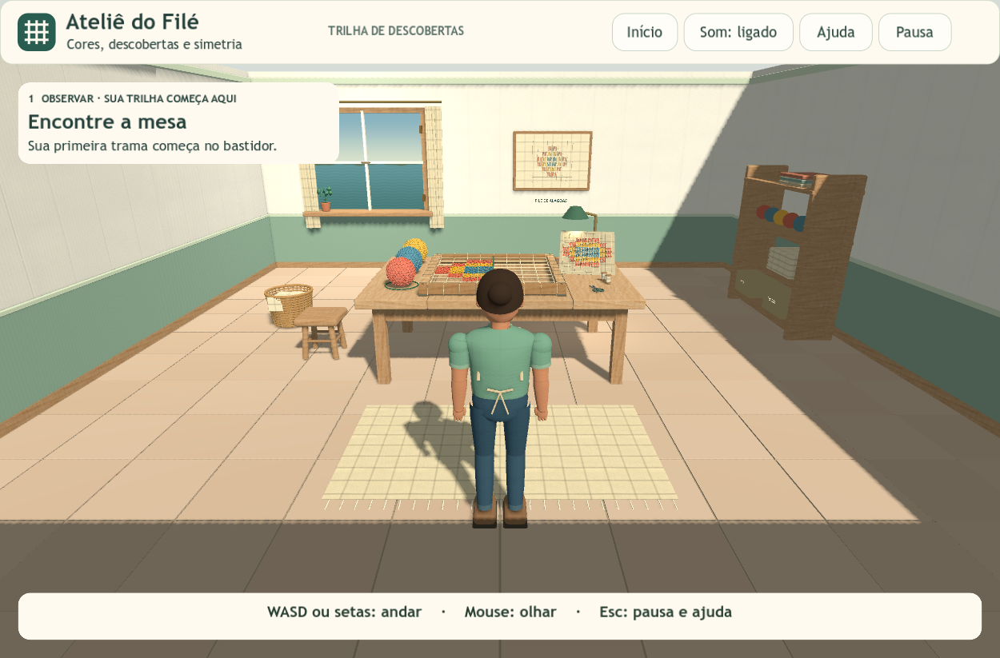

# Entrega 3 — ambiente e integração

**Registro de 12/10/2026.** A interface atual é documentada na [Trilha de descobertas](trilha-de-descobertas.md).

## Implementado

- Acabamento da sala: faixa verde nas paredes, arremates, janela com paisagem ilustrada, detalhes de ferragens, planta e quadro.
- Utensílios e objetos: cesto, tesoura, carretéis, novelos na estante, tecidos dobrados e travessas da banqueta.
- Piso: ladrilhos com pequenas variações, combinados em sete lotes de geometria; colisão contínua para a caminhada.
- Áudio: passos diferentes no piso e no tapete, emitidos junto à personagem, transições e ambiente discreto sintetizado. Mute e volume controlam todos os sons.
- Câmera: retorno suave após afastar-se de obstáculos e transição entre caminhada e bastidor.
- Integração: atividade, exploração, pausa, ajuda, exemplo e transformações permanecem disponíveis na mesma cena.

As nove texturas externas e suas licenças estão descritas em [Texturas](texturas.md). A modelagem complementar é local. A janela mostra uma superfície ilustrada; não há cenário externo explorável.

## Arquivos para estudar

`tools/room_finishing.gd` constrói os objetos e os lotes do piso; `materials/window_view.gdshader` desenha a paisagem; `scripts/audio.gd` organiza ambiente e passos; `scripts/player.gd` controla a caminhada e a câmera. As cenas geradas já estão salvas: não é preciso executar os geradores para jogar.

## Evidências

A versão anterior à Trilha passou por 47 verificações de integração, 61 de interface e 39 de movimento. Os registros históricos estão em `evidence/entrega-03/`. A Trilha foi verificada novamente e tem relatórios próprios em `evidence/trilha-descobertas/`; consulte seu documento para os resultados e os pacotes atuais.

O acabamento é estilizado. A personagem usa segmentos articulados e animação procedural; não usa deformação de malha por esqueleto. Os testes automáticos verificam estados de áudio, mas não substituem avaliação auditiva ou uma sessão de uso com alunos.
