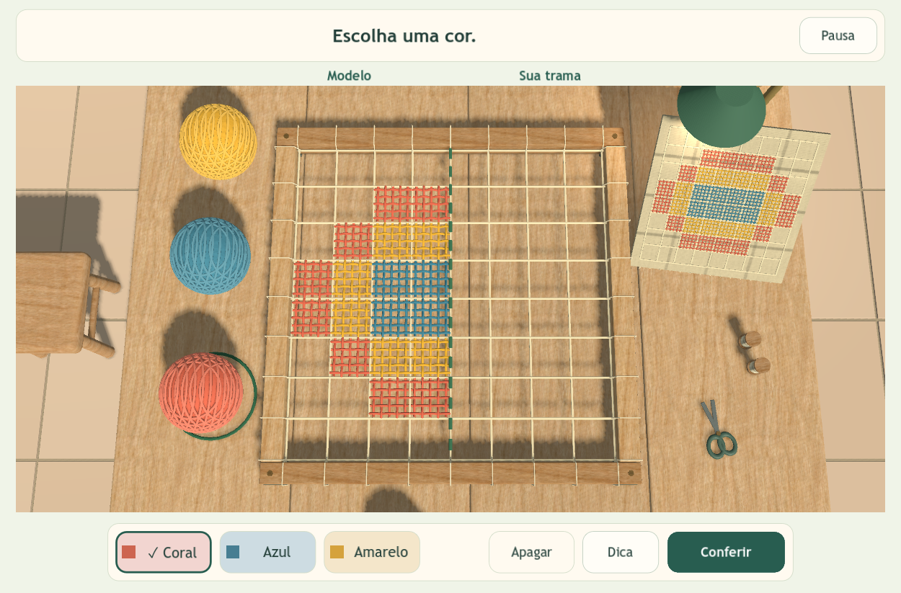
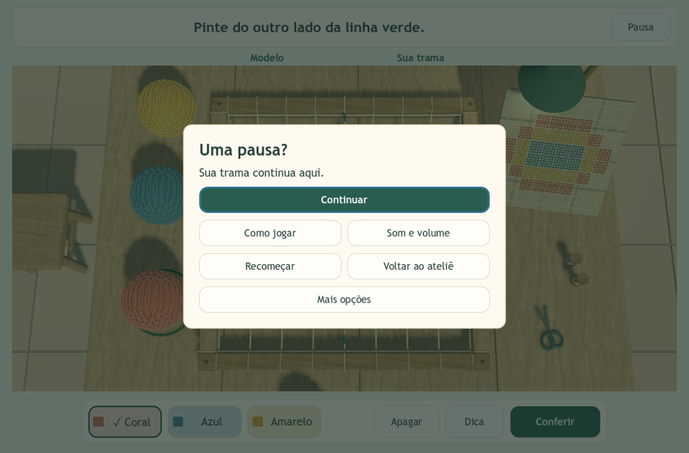
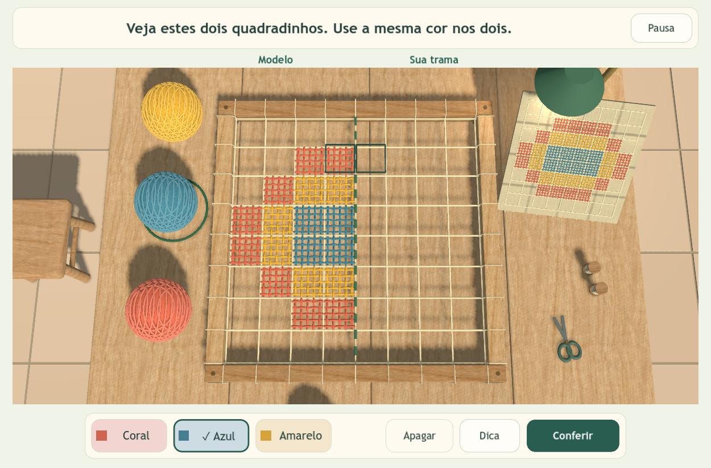

# Trilha de descobertas — interface simples no ateliê

**13/10/2026 · Godot 4.4.1 · 4º ano · computador com teclado e mouse**

**Atualização de som:** o menu agora possui volumes separados para Música e Efeitos e ambiente. Os sete botões da atividade permanecem. Veja o [menu atualizado e os testes de áudio](audio.md).

A atividade reúne uma interface curta e a ambientação completa do ateliê. O bastidor é visto sobre a mesa, com os novelos, a peça pronta e os utensílios ao redor. A vista mantém a inclinação da primeira Trilha de descobertas e ocupa a largura disponível. Malha, fios, madeira, objetos e sombras continuam tridimensionais. A interface usa componentes nativos da Godot.

## O que a criança vê durante a atividade

- **Uma instrução no alto**, atualizada conforme a ação: escolher cor, pintar, apagar ou observar uma dica.
- **Bastidor centralizado dentro do ateliê**, com as indicações “Modelo” e “Sua trama”.
- **Sete botões:** Coral, Azul, Amarelo, Apagar, Dica, Conferir e Pausa. A cor selecionada tem nome, contorno e marca de seleção.
- **Câmera fixa para pintar.** Arrastar não pinta nem gira a câmera; a roda não altera o enquadramento.
- **Texturas, relevo e sombras originais**, com novelos, peça de inspiração, luminária e utensílios visíveis. Os novelos também permitem escolher uma cor por clique.

A orientação lateral, as instruções repetidas e a trilha permanente saíram da tela de pintura. **Observar → Criar → Descobrir** aparece na abertura e na conclusão. O cenário conserva seus materiais e objetos ao alternar entre atividade, exploração, peça em destaque e apresentação de CG.

## Onde ficam as outras ações

| Ação | Caminho |
| --- | --- |
| Continuar | Pausa → Continuar, ou Esc |
| Ler a ajuda | Pausa → Como jogar |
| Ver a solução | Pausa → Como jogar → Ver exemplo completo |
| Recuperar a tentativa depois do exemplo | Voltar à minha tentativa |
| Observar a peça em 3D | Ver peça em destaque no exemplo ou Ver minha peça na conclusão |
| Girar e aproximar a peça | Arrastar e usar a roda na peça ou na apresentação de CG |
| Ajustar ou silenciar o áudio | Pausa → Som e volume |
| Apagar toda a tentativa | Pausa → Recomeçar → confirmar |
| Caminhar novamente | Pausa → Voltar ao ateliê |
| Demonstrar transformações | Pausa → Mais opções → Apresentação de CG |
| Reabrir a apresentação | Pausa → Mais opções → Tela de início |
| Fechar o jogo | Pausa → Mais opções → Fechar o jogo → confirmar |

Esc abre a pausa durante a atividade. Nos submenus, retorna à tela anterior. Ajuda, exemplo, pausa, abertura e exploração preservam a tentativa enquanto o jogo fica aberto. **Não há salvamento depois de fechar o jogo.**

## Organização do código

- `scripts/trail_ui.gd`: cabeçalho, barra de ferramentas, modais, foco e adaptação do layout.
- `scripts/main.gd`: navegação entre telas, pausa e retorno à atividade.
- `scripts/camera_rig.gd`: vista inclinada da bancada, fixa para pintar e com inspeção para peça/CG.
- `scripts/workshop.gd`: mensagens curtas e interação com as células.

O painel de CG mantém translação, rotação, escala, eixos e controle de sombras. Os desenhos são interpretações didáticas inspiradas no filé, sem atribuição a um padrão tradicional específico.

## Verificação

Executada em Godot 4.4.1, Windows, renderizador Compatibility. As capturas desta página foram produzidas pelo jogo e inspecionadas visualmente.

| Suíte e execução | Resultado | Evidência |
| --- | --- | --- |
| Interface no projeto | 128 verificações, zero falhas | `evidence/trilha-ambientacao/interfaces/results.json` |
| Integração no projeto | 55 verificações, zero falhas | `evidence/trilha-ambientacao/integracao/results.json` |
| Interface no executável Windows | 128 verificações, zero falhas | `evidence/trilha-ambientacao/exportado/interfaces/results.json` |
| Integração no executável Windows | 55 verificações, zero falhas | `evidence/trilha-ambientacao/exportado/integracao/results.json` |

As mesmas **183 verificações passaram no projeto e no executável exportado**. Elas cobrem os sete botões visíveis, limites da malha e das ferramentas, foco por teclado, janela mínima de 1000 × 680 e tela larga, pausa e submenus, seleção e pintura, apagar, conferência, dicas, exemplo sem perda da tentativa, confirmação de reinício e saída, exploração, áudio e transformações. Os testes também confirmam que a câmera permanece fixa ao pintar, permite girar e aproximar a peça, e volta ao enquadramento da atividade.

A ambientação é verificada durante a atividade, na peça, em CG e no retorno à exploração: materiais originais da mesa, intensidade de sombra e objetos visíveis. Novelos e peça de inspiração cabem junto do bastidor. O clique no novelo 3D escolhe a cor sem pintar a malha. Na janela mínima, o menor espaçamento entre centros de células vizinhas foi de **41,6 pixels**, acima do limite de 36 pixels usado pelo teste; isso verifica o tamanho da representação, sem substituir avaliação de usabilidade com crianças.

Os testes do Windows foram executados diretamente por `builds/Windows-Atelie/AtelieDoFile.exe`, carregando o `.pck`, sem apontar para a pasta do projeto. A exportação terminou com código zero. A comparação dos 53 arquivos do projeto original `godot-atelie-file` confirmou sua preservação; consulte `evidence/trilha-ambientacao/original-integrity.json`.

Os testes são técnicos e automatizados. Uma avaliação com estudantes do 4º ano ainda é necessária para verificar compreensão das instruções e facilidade de uso. O alvo desta versão é computador com teclado e mouse.
