# Planejamento das interfaces

**Registro da proposta anterior.** A alternativa escolhida posteriormente, **Trilha de descobertas**, já foi implementada e simplificada em 13/10/2026. Consulte as [telas atuais e o registro da simplificação](interface-simplificada.md). As capturas abaixo preservam a evolução anterior do projeto.

**Ateliê do Filé — Matemática nas Tramas · 12/10/2026**

Público: estudantes do **4º ano**, aproximadamente 9–10 anos, usando computador com teclado e mouse. O plano abaixo já foi aplicado ao protótipo Godot; as imagens são capturas reais.

## 1. Direção visual e de linguagem

- O ateliê continua protagonista. Papel claro, verde, coral, azul e amarelo conectam menus, fios e cenário.
- Uma ação principal por contexto. Instruções com verbos concretos: escolher, clicar, conferir, voltar.
- Texto de atividade entre 18 e 23 unidades da interface; títulos entre 28 e 40. Botões principais com pelo menos 52 unidades de altura e espaço entre ações.
- Cores acompanhadas de **nomes e contorno de seleção**. Foco de teclado visível, sem depender de som para explicar uma ação.
- Sem tempo limite, placar ou punição. A conferência aponta **um par de quadradinhos** para comparar, em vez de apresentar uma lista de erros.
- Ajuda dividida em três passos, acessível antes e durante a partida.
- A tentativa é preservada ao abrir ajuda, pausa, exemplo ou exploração. Reiniciar e fechar exigem uma escolha explícita para evitar perdas acidentais.
- Os termos acadêmicos de CG ficam em painel próprio, acessível para demonstração.

## 2. Caminho principal

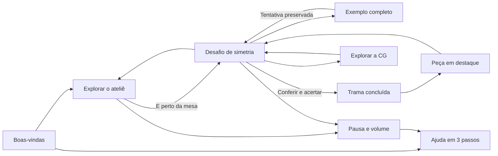

## 3. Telas e comportamento

| Tela | O que a criança vê | Ação principal |
| --- | --- | --- |
| Boas-vindas | Nome, bastidor ilustrado e convite para criar com cores | **Vamos começar!** |
| Exploração | Objetivo “Encontre a mesa”, cenário e lembrete de caminhada | **E — Começar minha trama**, apenas perto do bastidor |
| Desafio | Malha 3D em destaque; painel com escolha de cor, apagar, dica e conferência | **Conferir minha trama** |
| Ajuda | Uma página por assunto: explorar, espelhar, conferir | **Próxima dica / Entendi!**, retornando à tela anterior |
| Dica / correção | Mensagem acolhedora e contorno em duas células correspondentes | Comparar e continuar tentando |
| Exemplo | Malha preenchida, aviso de exemplo e ferramentas de edição recolhidas | **Voltar à minha tentativa** |
| Conclusão | Reconhecimento da conquista e explicação da simetria | **Ver minha peça** |
| Peça em destaque | Composição 3D centralizada e painel lateral recolhido | **Voltar ao desafio** |
| Pausa | Continuidade da tentativa, volume e som | **Continuar jogando** |
| Reinício / saída | Consequência descrita em uma frase; continuar em destaque | Cancelar ou confirmar |
| CG | Eixos, sombras e transformações do novelo com explicações breves | **Voltar ao desafio** |

### Boas-vindas

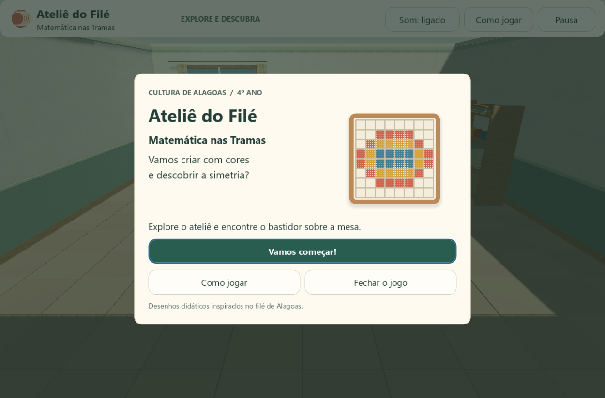

O início não captura o mouse automaticamente. A ilustração oferece uma referência do que será criado; a mensagem não exige que a criança conheça o termo “simetria” para começar.

### Exploração e aproximação

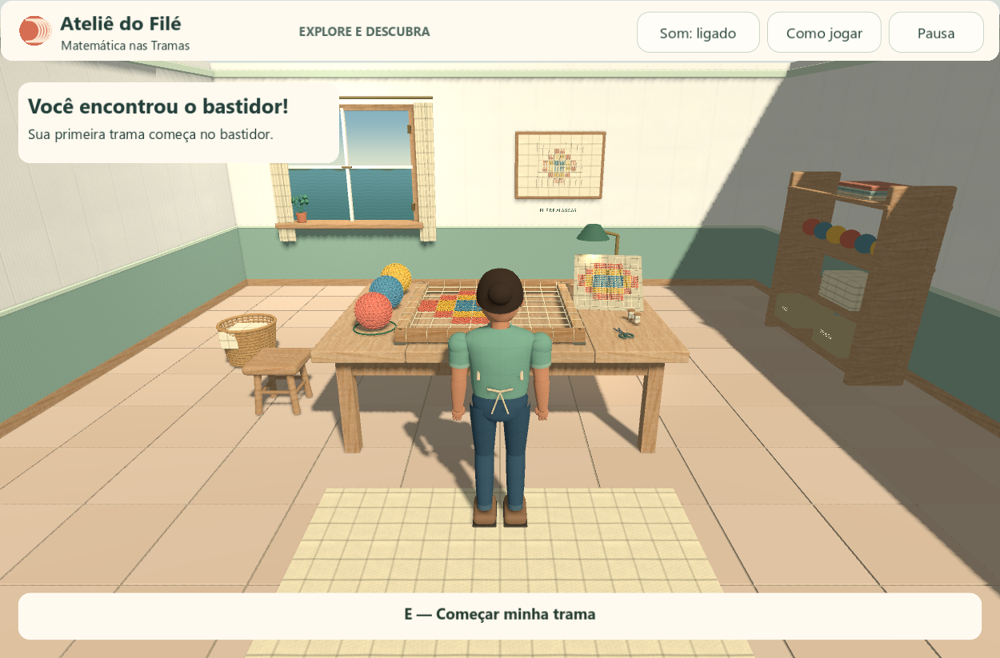

O objetivo muda quando a personagem encontra a bancada. Os controles aparecem no contexto em que serão usados. Esc libera o cursor e abre a pausa durante a exploração.

### Desafio

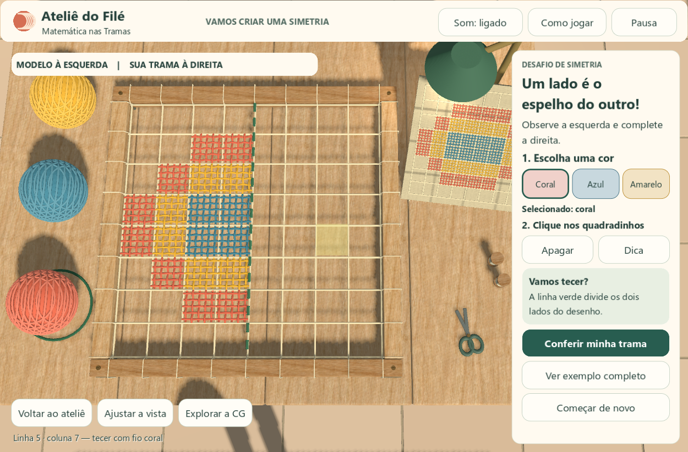

O modelo fica à esquerda do eixo e a tentativa à direita. A paleta usa nomes e borda de seleção. O botão de conferência fica junto da mensagem educativa. O novelo 3D também continua selecionável.

### Ajuda e retorno educativo

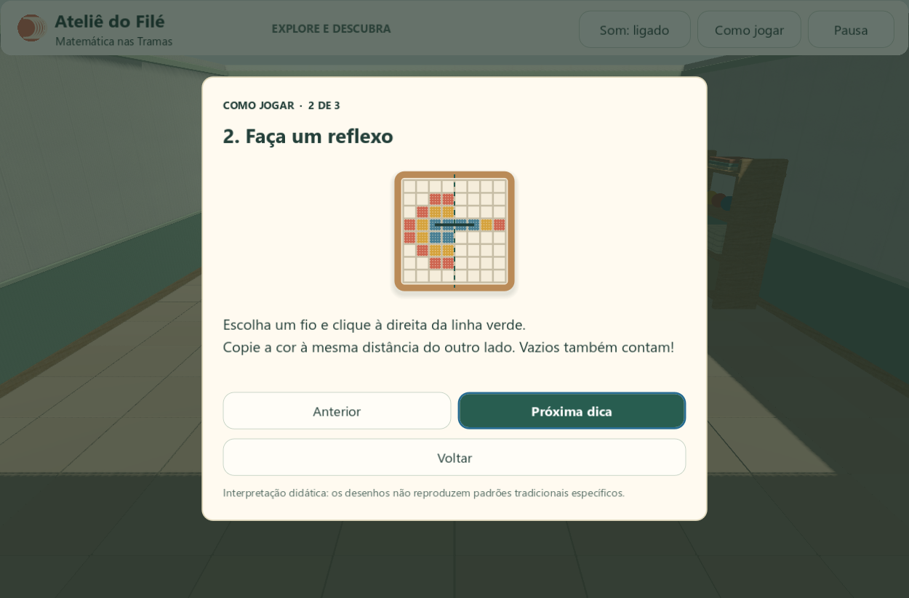

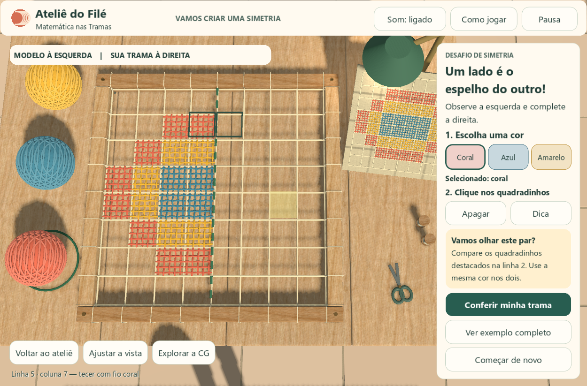

A dica identifica um par por vez e lembra que os espaços vazios também fazem parte da simetria. Abrir a ajuda bloqueia pintura e câmera, mas mantém a tentativa.

### Exemplo e peça pronta

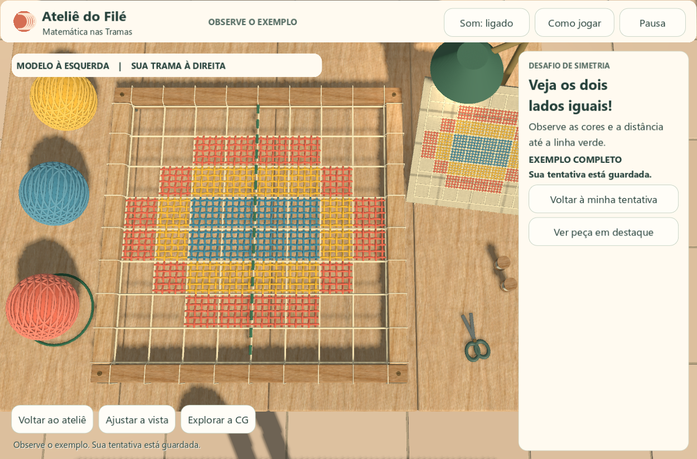

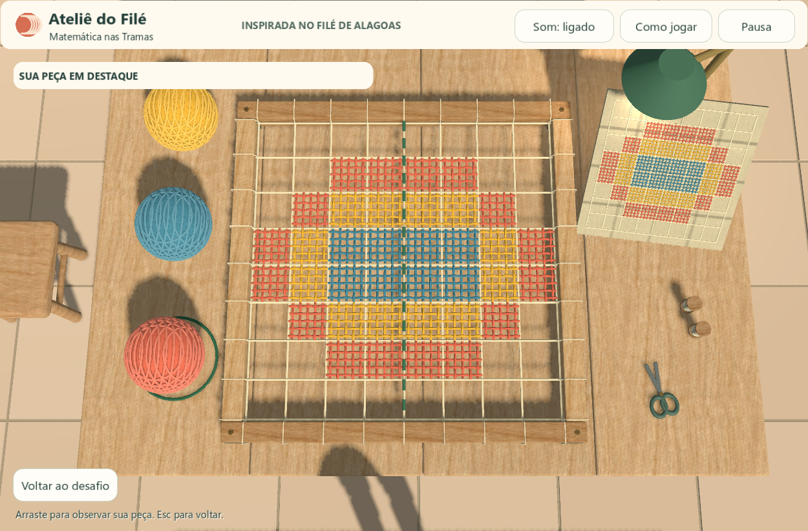

O exemplo é identificado como tal. A tela de conclusão só aparece após conferir uma tentativa correta. A peça em destaque usa a malha 3D real e permite observar a composição.

### Conclusão, pausa e CG

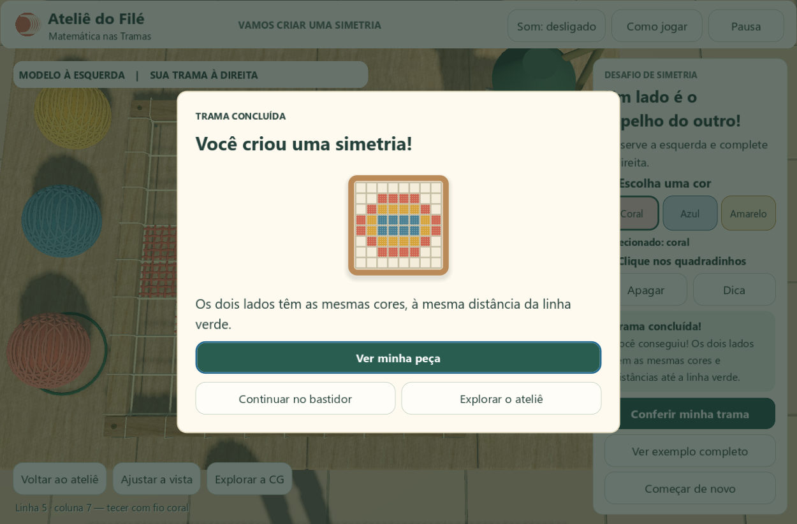

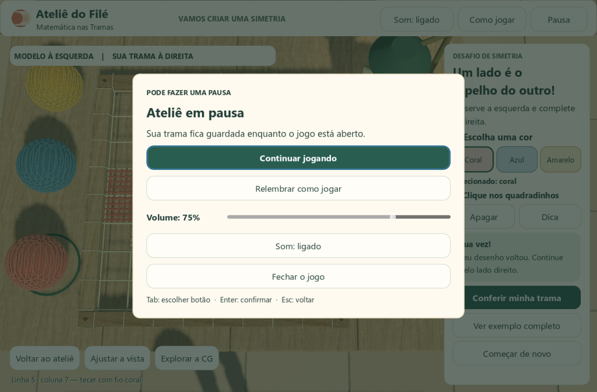

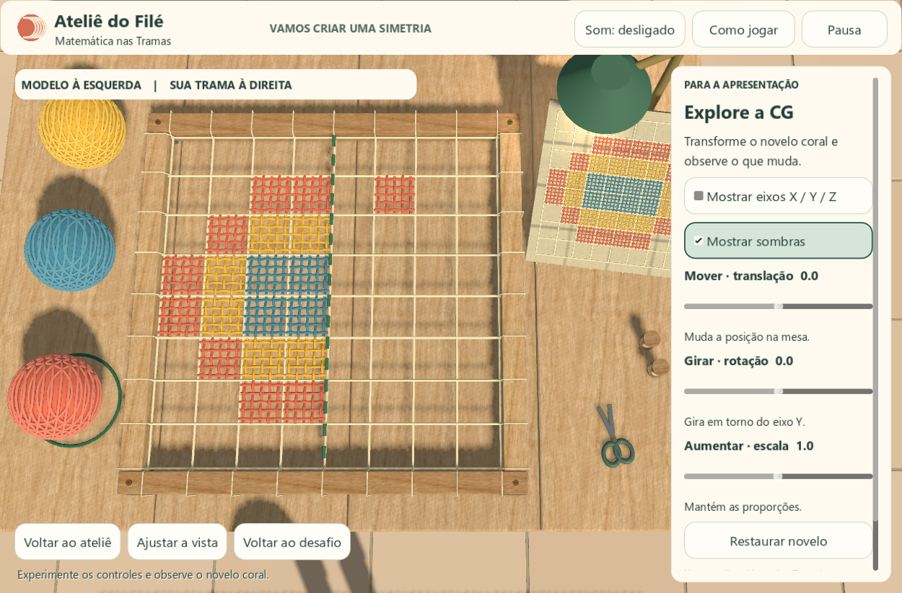

Não há classificação por rapidez. Os textos de translação, rotação e escala ficam separados das instruções matemáticas da criança, mantendo a apresentação acadêmica acessível.

## 4. Implementação

| Arquivo | Responsabilidade |
| --- | --- |
| `scripts/ui.gd` | Tema, botões, paleta, páginas, ajuda e foco dos diálogos |
| `scripts/ui_art.gd` | Ilustração de fios desenhada na própria Godot |
| `scripts/main.gd` | Abertura, pausa, retorno das telas e bloqueio dos controles |
| `scripts/workshop.gd` | Conferência e mensagens educativas |
| `scripts/board.gd` | Realce do par de células da dica |
| `scripts/camera_rig.gd` | Enquadramento no espaço disponível da interface |
| `tests/interface_test.gd` | Fluxos de telas, preservação da tentativa, foco e capturas |

O alvo é **computador**, com janela mínima de 1000 × 680. A Godot redimensiona a interface; o painel lateral permite rolagem se necessário. Isso não representa suporte a celular ou tela sensível ao toque. Tab e Enter navegam pelos controles; a interação espacial com a malha continua dependendo do mouse.

## 5. Avaliação com o público

As verificações automáticas cobrem os fluxos técnicos e as capturas permitem revisar a composição. A próxima avaliação com alunos deve observar: encontram a mesa sem orientação externa; compreendem o eixo; distinguem a tentativa do exemplo; conseguem voltar da ajuda; usam a dica para corrigir uma célula. Essa avaliação com crianças **ainda não foi realizada**.

Referências de implementação: [foco e navegação — Godot 4.4](https://docs.godotengine.org/en/4.4/tutorials/ui/gui_navigation.html). Os alvos amplos seguem a orientação de facilitar a seleção em [W3C — Target Size](https://www.w3.org/WAI/WCAG22/Understanding/target-size-enhanced.html); seu uso isolado não declara conformidade WCAG para o jogo.
