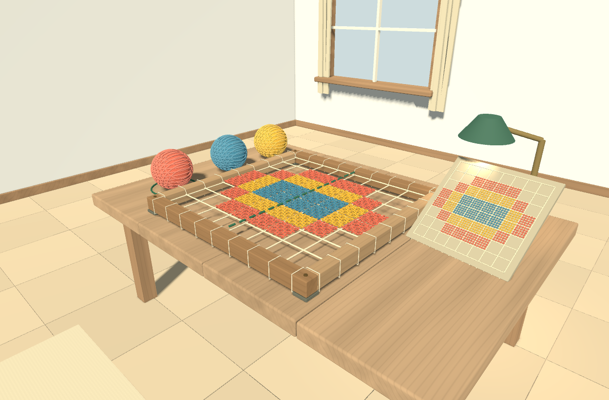
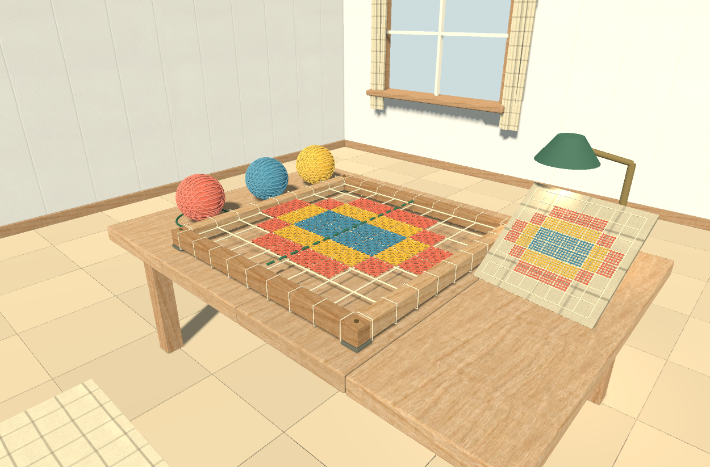
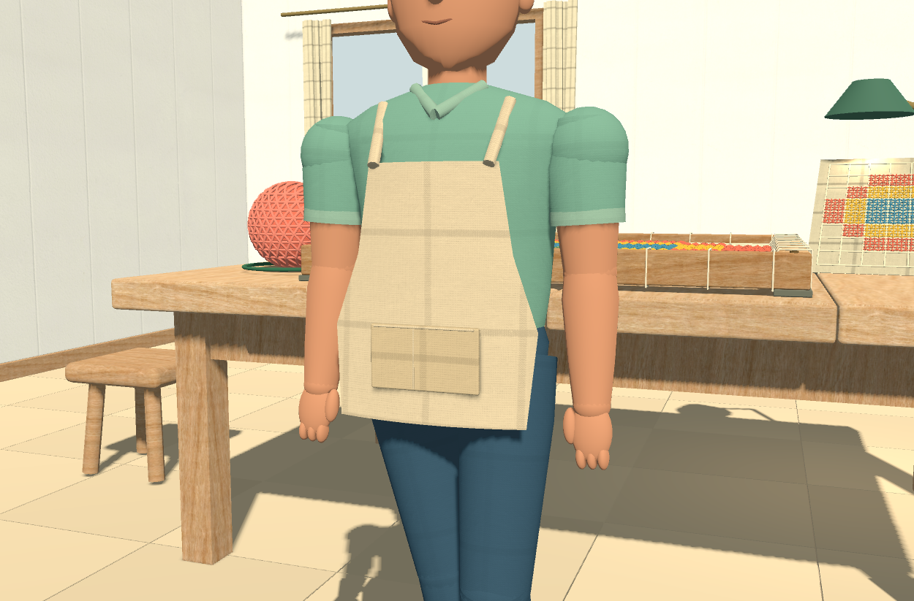

# Complemento da Entrega 2 — texturas

Atualização de **11/10/2026**. O projeto agora utiliza imagens de materiais na madeira, nos tecidos e nas paredes. Esta é uma melhoria de acabamento sobre a Entrega 2; os demais itens da Entrega 3 continuam pendentes.

## Comparação real na Godot

### Antes

### Depois

### Roupa e avental

As capturas usam o mesmo cenário, iluminação e enquadramento, sem retoque. Os fios do desafio continuam sendo geometria tridimensional. A textura genérica de tecido aplicada à roupa e aos objetos de apoio não representa um padrão tradicional de filé.

## O que foi aplicado

| Material | Aplicação | Tratamento |
| --- | --- | --- |
| Madeira | Mesa, bastidor, porta, assento, prateleira e acabamentos | Veios orientados por peça; deslocamento da imagem entre tábuas; poros e rugosidade |
| Tecido | Roupa, avental, tapete, cortinas e peças de apoio | Trama com relevo sutil; contraste reduzido na roupa; cores originais preservadas |
| Reboco | Paredes | Variação de superfície e relevo; projeção contínua entre trechos adjacentes |

São **nove mapas 1K**, totalizando aproximadamente **12,1 MiB** em arquivos de origem, todos incluídos no projeto. O jogo funciona offline. Fontes, autores, licença CC0 e hashes estão em [CREDITOS.md](../CREDITOS.md) e `textures/polyhaven/sources.json`.

## Como isso se encaixa em Computação Gráfica

- **Cor / albedo:** a imagem descreve a aparência da superfície, por exemplo os veios da madeira.
- **Normal map:** modifica a direção usada no cálculo da iluminação. Faz poros e fibras parecerem ter relevo, sem acrescentar vértices. Não altera silhueta ou colisões.
- **Rugosidade:** controla a dispersão do brilho. A madeira e o tecido respondem de forma diferente à luz.
- **Mapeamento:** os shaders projetam a imagem em três planos e misturam as projeções conforme a orientação da superfície. Isso atende às malhas geradas por código que ainda não têm UVs, as coordenadas que normalmente posicionam uma imagem sobre um modelo.
- **Transformações:** na roupa, as coordenadas acompanham cada parte da personagem; nas paredes estáticas, usam a posição no mundo para manter continuidade. A escala considera o tamanho dos objetos em metros.
- **Filtragem:** mipmaps e filtragem anisotrópica reduzem cintilação e perda de detalhe quando a superfície fica distante ou inclinada.

Referências: [materiais na Godot 4.4](https://docs.godotengine.org/en/4.4/tutorials/3d/standard_material_3d.html) e [shaders espaciais](https://docs.godotengine.org/en/4.4/tutorials/shaders/shader_reference/spatial_shader.html).

## Para a equipe experimentar

1. Abra `scenes/ambiente.tscn`, selecione uma `TabuaAcabada` dentro de `Bancada/Mesa` e expanda **Material Override → Shader Parameters**.
2. Compare `texture_strength` em 0 e 0,8: a geometria é a mesma, mas a variação de cor muda.
3. Compare `relief_strength` em 0 e 0,3 com iluminação lateral: observe como a textura reage à luz.
4. Ajuste `meters_per_tile`: valores maiores ampliam o tamanho físico dos detalhes. Evite fibras ou poros desproporcionais.

Os recursos já estão aplicados. `tools/apply_textures.gd` serve para reaplicá-los às cenas existentes; os geradores também foram atualizados. Reexecutar esses scripts pode substituir ajustes manuais dos materiais. Não é necessário executá-los para jogar.

## Validação e limites

- **40 verificações de integração aprovadas**, incluindo exploração, colisões, pintura/apagamento, solução, retomada, som e pausa. O modelo matemático também passou.
- Importação final e revisão gráfica concluídas sem erros de script ou shader.
- O ensaio inicial revelou escala duplicada em cliques simulados na janela de 1250 × 824. O teste passou a enviar coordenadas locais ao viewport; os controles do jogo não foram alterados. A execução inicial foi conservada em `integration-coordenadas.log`.
- Os 53 arquivos registrados do projeto original `godot-atelie-file` permaneceram inalterados. O backup anterior a este complemento está em `entregas/exploracao-antes-texturas.zip`, na pasta superior.

Amostra local: Godot 4.4.1, Compatibility, RX 7600, janela 1250 × 824, VSync desligado apenas no ensaio, 60 quadros de aquecimento e 180 medidos por enquadramento.

| Enquadramento | Mediana antes → depois | Percentil 95 antes → depois | Chamadas de desenho |
| --- | --- | --- | --- |
| Exploração | 2,064 → 2,119 ms | 2,906 → 3,196 ms | 1498 → 1498 |
| Solução no bastidor | 1,370 → 1,418 ms | 1,934 → 2,233 ms | 1164 → 1164 |

As texturas aumentam o trabalho por pixel e o uso de memória. A amostra curta não é uma garantia de FPS. A execução anterior avisou que não podia gravar cache de shaders; a posterior tinha acesso ao cache. Por isso, os tempos são uma referência local, sem afirmar uma medição isolada do custo das texturas. Os dados completos estão em `evidence/texturas/antes/` e `depois/`.

O acabamento permanece estilizado. Não há deformação física de tecido ou relevo geométrico produzido pelas imagens. A repetição pode ser percebida em superfícies grandes, e as paredes seguem sem teto conforme o escopo anterior. Iluminação, detalhes do cenário e apresentação final ainda poderão evoluir na Entrega 3.
