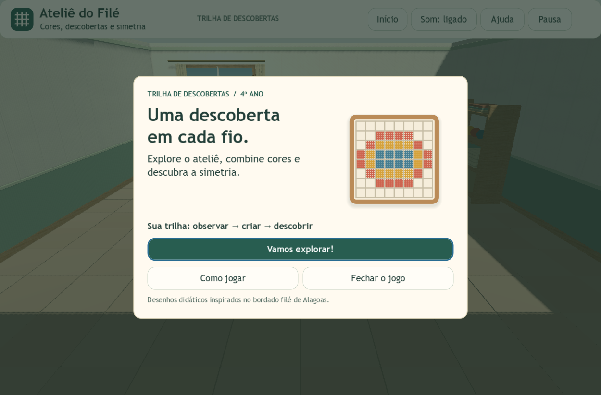
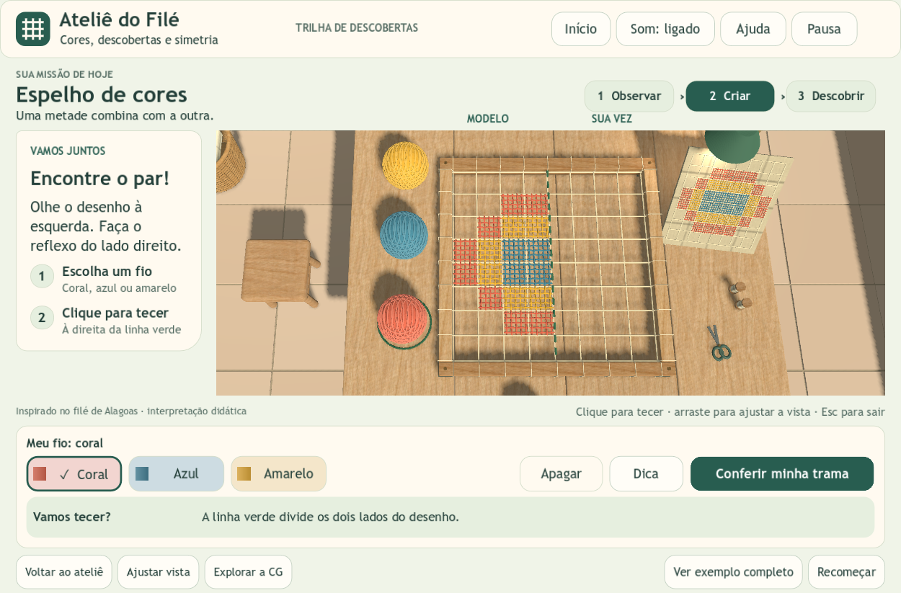
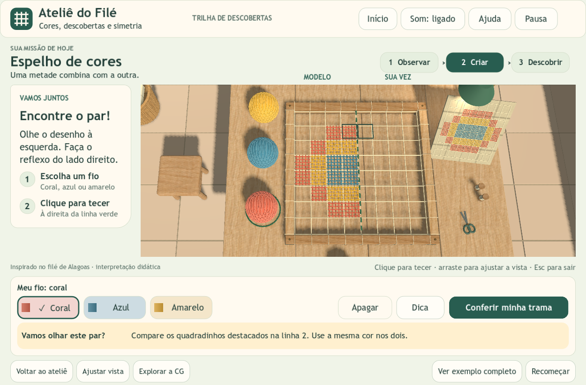
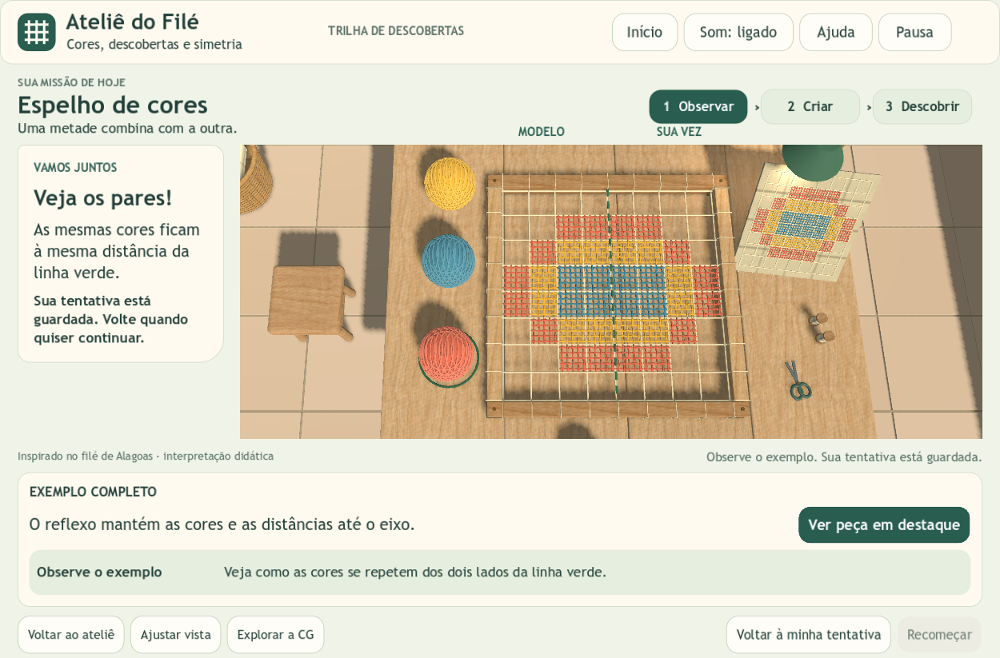
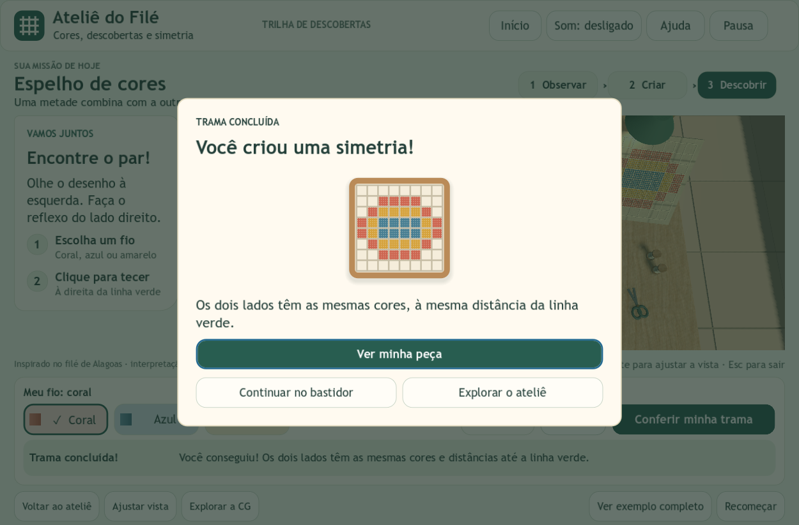
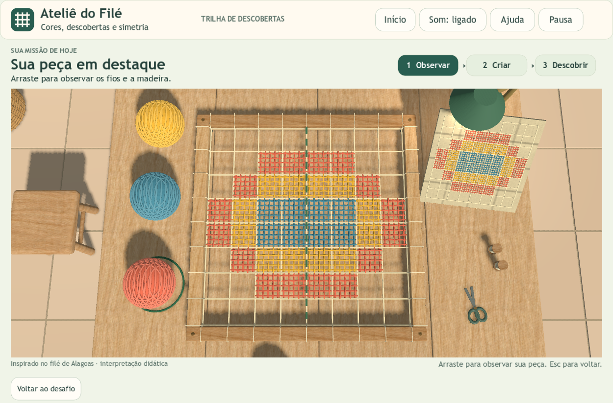

# Trilha de descobertas — implementação na Godot

**Registro histórico de 12/10/2026.** A tela de atividade foi simplificada em 13/10: sete botões, uma instrução e malha maior. Consulte a [interface atual, navegação e testes](interface-simplificada.md). As capturas e os resultados abaixo documentam a primeira implementação.

**12/10/2026 · Godot 4.4.1 · estudantes do 4º ano · computador com teclado e mouse**

A proposta visual escolhida foi aplicada ao jogo existente. O cenário, a personagem, os fios, os novelos, as sombras e a interação com a malha continuam em 3D. A interface usa nós nativos `Control` da Godot, sem HTML ou navegador embutido.

## Como experimentar

Importe `project.godot` na Godot 4.4.1 e pressione **F5**, ou abra o pacote Windows separado. Clique em **Vamos explorar!**, caminhe até a frente da mesa e pressione **E** quando o convite aparecer. Na bancada, escolha uma cor, clique à direita do eixo e use **Conferir minha trama**.

## Telas implementadas

| Contexto | Organização e comportamento |
| --- | --- |
| Boas-vindas | “Uma descoberta em cada fio”, bastidor ilustrado e convite para explorar |
| Observar | Objetivo contextual na exploração; exemplo completo identificado como referência |
| Criar | Missão no alto, orientação à esquerda, bastidor central e ferramentas embaixo |
| Dica | Um par de células destacado e mensagem curta para comparar cores e distâncias |
| Descobrir | Etapa liberada após conferir a simetria correta, com explicação do resultado |
| Peça em destaque | Mais espaço para observar a composição 3D; arrasto e retorno ao desafio |
| Ajuda e pausa | Ajuda em três páginas, controle de volume, som e retomada da tentativa |
| Reinício e saída | Consequência explicada antes de confirmar; cancelar preserva a atividade |
| Explorar a CG | Painel próprio com translação, rotação, escala, eixos e sombras |

As etapas são indicadores do contexto, não botões de fases. Ver o exemplo não conclui o desafio. A tentativa fica guardada ao abrir o exemplo, a ajuda, a pausa, a abertura ou a exploração. Ela não é salva depois de fechar o jogo.

### Abertura

### Atividade

Fundo verde suave, cartões de papel, botões grandes e instruções em dois passos. Coral, azul e amarelo têm nomes, amostras e contorno de seleção; a seleção também recebe uma marca. Não há tempo limite ou placar.

### Dica, exemplo e conclusão

### Peça em destaque

Os motivos são interpretações didáticas inspiradas no filé de Alagoas, sem atribuição a padrões tradicionais específicos.

## O que estudar no código

| Arquivo | O que observar |
| --- | --- |
| `scripts/trail_ui.gd` | Composição da Trilha, paleta, etapas e adaptação das áreas de tela |
| `scripts/ui.gd` | Tema compartilhado, componentes, diálogos, ajuda e foco de teclado |
| `scripts/ui_art.gd` | Desenho vetorial do símbolo e das ilustrações com `_draw()` |
| `scripts/camera_rig.gd` | Campo de visão e deslocamentos da câmera para enquadrar a área livre |
| `scripts/main.gd` | Transições entre exploração, trabalho e pausa; abertura e conclusão |
| `scripts/workshop.gd` | Consulta 3D pelo mouse, pintura e retorno educativo |
| `scripts/challenge.gd` | Regra matemática independente da interface |

O enquadramento considera largura e altura disponíveis. Os deslocamentos horizontal e vertical da câmera alinham o bastidor ao centro dessa área. A pintura continua usando um raio lançado pela câmera contra as colisões das células; clicar nos botões não pinta a cena por baixo.

## Verificação

- **82 verificações de interface**, sem falhas: abertura, ajuda, foco de teclado, etapas, tentativa preservada, exemplo, conclusão, pausa, volume, confirmações e limites visuais.
- **49 verificações de integração**, sem falhas: cliques em novelos e células, paleta e dica, câmera, movimento, colisões, transformações, áudio e retorno entre exploração e atividade.
- Janelas solicitadas nos testes: padrão do projeto, **1000 × 680** e **1600 × 900**. As 64 células e os três novelos ficam na área 3D no enquadramento inicial; os controles não se sobrepõem.
- Capturas acima produzidas pela Godot e inspecionadas visualmente. Relatórios em `evidence/trilha-descobertas/interfaces/results.json` e `evidence/trilha-descobertas/integracao/results.json`.
- As mesmas **131 verificações** passaram também no executável Windows exportado, carregando seus recursos pelo `.pck`, sem usar o projeto-fonte como diretório de execução. Relatórios em `evidence/trilha-descobertas/exportado/`.
- A pasta original `godot-atelie-file` permanece preservada: comparação de **53 arquivos** com o registro SHA-256, sem diferenças.

Os testes são técnicos. A compreensão e a facilidade de uso ainda precisam ser avaliadas com estudantes. Esta versão é para computador; não acrescenta controles por toque, novas fases ou persistência entre sessões.

## Pacotes

- `atelie-file-trilha-descobertas-godot.zip`: projeto editável, documentação e evidências, sem o cache `.godot` e sem executáveis aninhados.
- `atelie-file-trilha-descobertas-windows.zip`: jogo exportado para Windows x86_64; extraia a pasta completa e mantenha `.exe` e `.pck` juntos.
- `antes-trilha-de-descobertas-2026-10-12.zip`: cópia do projeto anterior a esta alteração.
